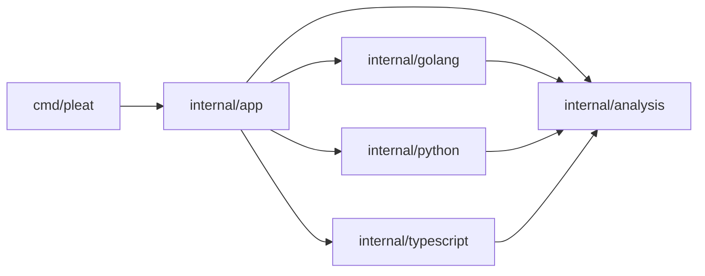

# Project layout

Implemented application layout for [VISION.md](VISION.md).
One Go module at the repository root, with no public library API.

## Disk layout

```text
pleat/
├── .agents/
│   └── skills/
├── .gitignore
├── README.md
├── VISION.md
├── DESIGN.md
├── go.mod
├── go.sum
├── bin/
│   └── pleat
├── cmd/
│   └── pleat/
│       └── main.go
└── internal/
    ├── app/
    │   ├── command.go
    │   ├── config.go
    │   ├── select.go
    │   ├── run.go
    │   ├── text.go
    │   ├── json.go
    │   ├── run_test.go
    │   ├── config_test.go
    │   ├── select_test.go
    │   └── testdata/
    │       ├── orders.go
    │       ├── orders.py
    │       └── orders.ts
    ├── analysis/
    │   ├── report.go
    │   └── settings.go
    ├── golang/
    │   ├── analyze.go
    │   ├── layout.go
    │   ├── analyze_test.go
    │   └── testdata/
    │       ├── dense.go
    │       ├── grouped.go
    │       ├── edges.go
    │       └── partial.go
    ├── python/
    │   ├── analyze.go
    │   ├── layout.go
    │   ├── analyze_test.go
    │   └── testdata/
    │       ├── dense.py
    │       ├── grouped.py
    │       ├── edges.py
    │       └── partial.py
    └── typescript/
        ├── analyze.go
        ├── layout.go
        ├── analyze_test.go
        └── testdata/
            ├── dense.ts
            ├── grouped.ts
            ├── edges.ts
            └── partial.ts
```

## File ownership

| Location | Responsibility |
| --- | --- |
| `go.mod`, `go.sum` | Module identity and pinned parser dependencies. |
| `bin/pleat` | Generated local executable, ignored by Git. |
| `cmd/pleat/main.go` | Process entry, cancellation, streams, and applying the exit code from `app.Run`. |
| `internal/app/command.go` | `Run` entry, argument validation, output selection, and exit-code mapping. |
| `internal/app/config.go` | TOML loading, named tunable code defaults, and validation into `analysis.Settings`. |
| `internal/app/select.go` | Explicit-file selection, Git diff selection, and report-path normalization. |
| `internal/app/run.go` | Read source once, dispatch by language, aggregate file results, sort findings, and derive run status. |
| `internal/app/text.go`, `json.go` | Render the same `analysis.Report` without changing findings or status. |
| `internal/analysis/report.go` | Finding, level, coverage, operational-error, file-result, and report data types. |
| `internal/analysis/settings.go` | Rule identifiers and concrete settings for the three layout checks. No execution logic. |
| Each language's `analyze.go` | Parser integration, source positions, trustworthy regions, parser cleanup, and file-result construction. |
| Each language's `layout.go` | Statement classification, source-gap inspection, and the three language-specific layout rules. |
| Package-local tests and `testdata/` | CLI behavior, configuration errors, Git selection, layout findings, and reduced coverage. |

## Package dependencies

Arrows denote imports.



## Boundaries

- Language adapters accept source bytes, a path, and validated settings, then return `analysis.FileResult`.
- `analysis` contains boundary data only. It imports no application, language, or parser package.
- Go uses the standard parser. Python and TypeScript use pinned Tree-sitter grammars. Parser nodes stay private.
- Unknown constructs produce coverage limitations. Parser failures produce operational errors. Neither becomes a readability finding.
- Shared rule policy is documented in `VISION.md`. Language-specific interpretation stays local and is checked against matching fixture cases.
- Seed fixtures from the documented experiments. Tests assert findings, levels, locations, coverage, and exits rather than parser-tree shapes or exact comment wording.
- `select_test.go` creates Git state in temporary repositories, not committed `.git` fixtures.
- `.agents/` is development guidance, not an application dependency.

## Layout decisions

Keep configuration, selection, orchestration, and renderers as files in `app` rather than separate one-purpose packages.
The tradeoff is a broader orchestration package with fewer cross-package contracts.
Language-specific rule code remains separate instead of sharing a universal AST.

No `pkg/`, plugin registry, helper-process implementation, metrics directory, stub backend, or Linux release machinery initially.
New source paths require working behavior. Go, Python, and TypeScript now share the implemented result contract.
