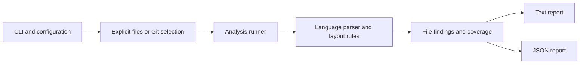

# Pleat

Pleat is a Go CLI that checks the visual layout of code for human readability.
Its first user runs macOS and uses findings in a coding-agent workflow.
Linux is a later target, not an initial release requirement.

This document records the product direction and recommended design.
The implementation follows [DESIGN.md](DESIGN.md).
[README.md](README.md) covers building, configuration, and report consumption.
The layout profile remains provisional while its usefulness is evaluated on real code.

## The promise

Pleat flags dense or awkward statement layout using deterministic, explainable rules inspired by [wsl](https://github.com/bombsimon/wsl).
It gives a developer or agent a reason to inspect a particular part of a file.
The required initial behavior is layout analysis, not a suite of complexity metrics.

Findings are advisory.
An agent can change the code or explain why the recommendation does not fit its context.
The agent records that reasoning in its own review output.
Disagreement does not change Pleat's observations or turn failed analysis into a clean result.
Pipeline policy remains the caller's responsibility.

Pleat does not promise a scientifically validated measure of code quality.
The standard is practical usefulness in review, supported by repeatable observations.
Source locations, statement boundaries, and documented counts must be dependable.
Whether a suggested blank line improves readability remains a judgment.
Levels indicate review priority, not correctness or confidence.

The tool does not infer domain concepts, prove cohesion, execute project code, or rewrite source.
It complements formatters, tests, and other linters.
For maintainers, the goal is a small analysis path with language-specific syntax handling and one result format.

## Initial scope

The initial platform is macOS, with verification on the user's current arm64 machine.
There is no requirement for Linux packaging, Intel Mac verification, or a pure-Go build before the first usable version.
Avoid unnecessary macOS dependencies so that Linux support remains practical later.

The target source files are Go `.go` files, Python 3 `.py` files, and plain TypeScript `.ts` files.
Python 2, JavaScript, JSX, TSX, and embedded languages are outside the initial scope.
No type checking, dependency installation, or complete language-version certification is required for layout analysis.

Syntax support is best effort, but findings must use trustworthy statement boundaries.
A language adapter can skip a rule or an affected block when it cannot interpret a construct reliably.
It must report that reduced coverage rather than guess at the structure.
If the parser cannot establish independent safe regions, skip the file and report the reason.
A damaged enclosing block is not a safe basis for statement-group findings.
Other valid files retain their results.

This permits useful analysis without requiring support for every new language feature.
It does not mean silently treating every physical line as a statement.

## A concrete caller

A developer checks one file or an explicit set of files.
An agent can check the current changes and consume JSON.
The CLI supports these invocations.

```sh
pleat check src/orders.py
pleat check src/orders.py web/orders.ts internal/orders.go
pleat check --diff HEAD --format json
pleat check src/orders.py --config .pleat.toml --format json
```

Explicit file selection and `--diff` are mutually exclusive.
Omitting both is a usage error.
Text is the default format.
JSON stdout contains only the report, without progress messages or ANSI escapes.

### Diff means changed files

`--diff BASE` compares the working tree with one resolved Git commit.
`--diff HEAD` includes the final state of staged and unstaged tracked changes, using working-tree contents rather than an index snapshot.
A staged edit that an unstaged edit reverses is not a net change.
The base is the named commit, not an implicit merge base.
This follows the distinction in the [Git diff documentation](https://git-scm.com/docs/git-diff).

Pleat checks complete changed files because layout depends on surrounding statements and block boundaries.
Findings outside changed lines remain visible.
Changed files are not the same as newly introduced findings.
Finding baselines are later work.

Renames use the destination path.
Deleted files are recorded as skipped and are not parsed.
Untracked files require explicit selection.
An empty diff produces an explicit empty-scope report, not a claim that the repository passed.
An invalid base, an unborn `HEAD`, or unresolved merge conflicts produces an operational error.

## WSL-inspired layout rules

The motivating problem is generated code with several steps pressed together.
The following function has nine executable sibling statements without a blank line.

```python
def create_order(request):
	customer = get_customer(request.customer_id)
	items = resolve_items(request.items)
	validate_customer(customer)
	validate_stock(items)
	subtotal = calculate_subtotal(items)
	tax = calculate_tax(customer, subtotal)
	order = save_order(customer, items, subtotal, tax)
	publish_order_created(order)
	return order
```

The preferred layout makes the author's intended groups visible.

```python
def create_order(request):
	customer = get_customer(request.customer_id)
	items = resolve_items(request.items)

	validate_customer(customer)
	validate_stock(items)

	subtotal = calculate_subtotal(items)
	tax = calculate_tax(customer, subtotal)

	order = save_order(customer, items, subtotal, tax)
	publish_order_created(order)

	return order
```

Pleat flags the uninterrupted run and the crowded return in the first example under the initial rules.
It cannot infer that validation, calculation, persistence, and publication are the correct conceptual groups from these names alone.
It must not claim to reconstruct the second example automatically.

WSL-style analysis is more than counting lines between blank lines.
It also considers which statements belong directly beside one another.
The [wsl checks](https://raw.githubusercontent.com/bombsimon/wsl/main/CHECKS.md) provide concrete examples of adjacency policies, short-block exceptions, and Go error-handling patterns.
Pleat takes that approach without promising compatibility with every wsl rule.

### The first rule profile

Start with three rules rather than implementing every proposed check.
The following defaults are engineering starting points, not validated readability thresholds.
All three rules are enabled in the initial profile and remain advisory.

| Rule | Behavior | Initial level |
| --- | --- | --- |
| `layout.max-statement-run` | Flag more than six executable sibling statements without a separating blank line. | `medium` |
| `layout.control-cuddle` | Require separation before an `if` or loop, except for a preceding group containing one assignment whose assigned name appears in the control header. | `medium` |
| `layout.return-separation` | Require separation before a return when its enclosing block contains more than two executable sibling statements. | `low` |

A multiline statement counts once.
Nested blocks are evaluated independently.
A compound statement counts once in its enclosing block.
Comments and Python docstrings do not count as executable statements.
Comment-only lines do not themselves separate a run.
A blank physical line between statements does separate a run, but a blank line inside a statement does not.

Control-header identifier matching is syntactic, not name resolution or data-flow analysis.
The rule permits a direct Go assignment-and-error-check pair without requiring a blank line between them.
A control statement that starts its block needs no leading separator.
Adapters must not split connected clauses, decorators, or comments attached to the following statement.
If an assignment form cannot be classified safely, skip that adjacency check and record the limitation.
A block containing only an assignment and a return remains accepted by the return rule.

The dense order example produces a run of nine statements and a return-separation finding.
The grouped example has a maximum run of two and already separates its return.
Those observations do not prove that every group is conceptually correct.

A small configuration can override the initial profile.
The six-statement limit is provisional and can change after reviewing actual findings.

```toml
[rules."layout.max-statement-run"]
enabled = true
level = "medium"
max = 6
```

Use an optional `.pleat.toml` in the invocation directory, or an explicit file selected with `--config`.
There is no parent-directory search or inheritance initially.
Unknown rule names, invalid levels, and invalid thresholds are configuration errors.
A recognized rule that cannot run on a construct produces a coverage limitation, not an invented finding.
No default rule uses `high` initially.
A caller can assign that priority without making it a correctness claim or an automatic process failure.

Evaluation should ask whether developers accept the suggested breaks and whether useful statement pairs stay together.
It should also look for arbitrary blank lines or unnecessary function extraction that satisfies a rule without improving readability.
There is no need to establish a scientific accuracy score before making the tool useful.

## A small report for the agent

Each finding contains a rule name, a `low`, `medium`, or `high` level, and a string comment.
Include a path and line so the agent knows which code to inspect.
Do not require a composite quality score, separate measurement stream, or confidence percentage.

Text and JSON render the same findings and coverage.
This is the complete JSON shape for the dense Python example under the initial profile.
It is illustrative, not captured CLI output.

```json
{
	"status": "complete",
	"findings": [
		{
			"rule": "layout.max-statement-run",
			"level": "medium",
			"path": "src/orders.py",
			"line": 2,
			"comment": "This run contains 9 statements. The provisional limit is 6. Consider separating related statement groups."
		},
		{
			"rule": "layout.return-separation",
			"level": "low",
			"path": "src/orders.py",
			"line": 10,
			"comment": "Consider a blank line before this return. Its block contains more than 2 executable statements."
		}
	],
	"coverage": [{"path": "src/orders.py", "status": "checked"}],
	"errors": []
}
```

Lines are one-based.
Paths are relative to the Git root in diff mode and the invocation directory in explicit-file mode.
Normalize path separators to `/`.
Order findings by path, line, and rule name.
The same source bytes, parser versions, and rule settings must produce the same ordered findings.

Coverage records each selected file as `checked`, `partial`, or `skipped`.
Partial or skipped entries include a reason and a line when a limitation is local.
Operational errors remain separate from readability comments.
An unsupported construct is a coverage limitation, not a `high` finding.
A missing parser runtime is an operational error if that runtime is required by the selected adapter.

The top-level status is `complete`, `partial`, `failed`, or `empty`.
`complete` means that all applicable checks ran on eligible files.
`partial` means some results remain available but an eligible file or region could not be checked fully.
`failed` means an operational failure prevented analysis altogether.
`empty` means selection succeeded but found no eligible code.
Deleted files and extensions outside the target languages are reported as skipped without making diff analysis partial.
An explicitly selected unsupported file is an invocation error.

An advisory run with no run errors exits `0`, regardless of finding levels.
This includes empty reports and partial reports caused only by explicitly skipped constructs.
Invalid invocation or parser, runtime, and analysis failures exit `2`, even when other files retain useful findings.
There is no built-in finding gate in the initial scope.
The pipeline can decide how to handle levels without forcing the agent to agree with Pleat.
An agent must inspect coverage rather than treating an empty report as evidence that all intended code was checked.

## A replaceable parser choice

The main path stays small.
Language adapters own syntax interpretation and layout-rule execution.
The runner owns selection, source loading, aggregation, and reporting.



The common adapter operation accepts source bytes, a path, and validated rule settings, then returns findings, coverage, and errors.
Parser nodes do not cross that boundary.
Layout rules inspect original source gaps rather than assuming that an AST retains whitespace.
The runner does not copy source into a universal AST or repeat language-specific decisions.

### The selected parser strategy

Keep the [standard Go parser](https://go.dev/src/go/parser/interface.go) for Go.
Use pinned [Tree-sitter Go bindings](https://github.com/tree-sitter/go-tree-sitter) with Python and plain TypeScript grammars for the other adapters.
The Python adapter targets Python 3.
Grammar acceptance of an older form does not make Python 2 a supported target.
The TypeScript adapter does not select the separate TSX grammar.
Each adapter owns parser cleanup and the interpretation of error or missing nodes.
Recovery must not be reported as complete coverage.

Two independent design candidates compared embedded parsers with native helper processes.
The embedded candidate is selected because it preserves the existing language-owned analysis boundary without adding runtime discovery or a cross-process layout-fact protocol.
The tradeoff is C-backed build dependencies and parser-resource management.
Those are acceptable for the initial macOS target, subject to continued smoke verification.

An isolated experiment on the current macOS arm64 machine built Go bindings `v0.25.0`, the Python grammar `v0.25.0`, and the TypeScript grammar `v0.23.2`.
Valid samples included comments, Unicode identifiers, multiline statements, and a decorated Python function.
Malformed Python and TypeScript samples produced syntax-error markers.
This establishes basic local integration, not full syntax coverage, layout correctness, or portable release packaging.

### Native helpers are a viable replacement option

A small Python helper can use the [standard-library AST](https://docs.python.org/3/library/ast.html) and tokenization to inspect source without importing the project.
A Python project having Python available is a reasonable initial assumption, but the selected interpreter determines which syntax it can parse.
A newer syntax feature can fail on an older interpreter.
The helper must report its runtime version and parsing limitations rather than claim support for all Python 3 features.

A native Python probe accepted source over JSON stdin and returned statement spans and comments over JSON stdout.
It ran under Python 3.15.0 with isolated startup and site initialization disabled, using `-I -S`.
The source included a top-level exception that was parsed but never executed.
Malformed source returned an explicit syntax error.
Python documents the startup behavior in its [command-line reference](https://docs.python.org/3/using/cmdline.html#cmdoption-I).

For TypeScript, a helper needs Node and a compatible compiler package, not merely a `.ts` file.
The [compiler API documentation](https://github.com/microsoft/TypeScript/wiki/Using-the-Compiler-API) demonstrates syntax traversal without type checking and warns about API-version changes.
A helper-based release should bundle a pinned compiler package rather than depend on arbitrary project versions or install packages during analysis.

If a helper replaces an embedded adapter, keep it scoped to one CLI invocation and terminate it when the run ends.
It is a child process, not an installed background service.
Keep parser objects private and return only the data that the adapter operation needs.
Do not implement both strategies or silently switch between them after a parse failure.
A replacement should be deliberate and keep the same finding and coverage contract.

## Metrics are future work, not stubbed results

Cyclomatic complexity, nesting depth, cognitive complexity, Maintainability Index, and architecture checks are examples of possible future analysis.
None is required for the initial layout tool.
They do not need settled rubrics, thresholds, or placeholder implementations now.

Keep the common analysis operation and result shape available to real implementations.
A future `NestingDepth` analysis can adopt that boundary when its behavior is defined and implemented.
Do not register no-op backends, return zero as a fake measurement, or report an unimplemented check as passed.
Add further interfaces only when a second working analysis needs them.

Maintainability Index remains worth investigating later.
Microsoft documents [one formula](https://learn.microsoft.com/en-us/visualstudio/code-quality/code-metrics-maintainability-index-range-and-meaning?view=visualstudio), but that does not establish a reusable implementation or make it a release requirement.
Finding baselines, automatic fixes, inline suppressions, third-party rules, and built-in enforcement are also deferred.

## Implemented delivery and calibration

The macOS CLI implements Go, Python 3, and plain TypeScript adapters with all three layout rules.
Explicit-file selection, mixed-language Git diffs, configuration, text, JSON, and advisory exits are connected.
The Go path was an implementation checkpoint, not the final delivery boundary.

Verification on macOS arm64 used Go 1.27.3.
`go test ./...`, `go test -race ./...`, and `go vet ./...` passed.
The built executable produced the six expected findings from the mixed-language dense fixtures and none from the grouped fixtures.
Repeated JSON was identical, and inspected source hashes were unchanged.
Real Git-workspace smoke checks covered staged and unstaged edits, net reversals, rename destinations, deletions, unsupported paths, empty scope, invalid bases, and merge conflicts.
Configured Git fsmonitor and filter helpers did not execute.
Known unsupported constructs retained partial coverage without run errors.
Malformed input retained good-file findings and exited `2`.

Package-local evals use experiment-derived inputs and literal findings, source locations, and coverage expectations.
They do not pin parser-tree shapes or explanation wording.
The Go gap-scanning regression confirms that blank lines inside block comments do not separate statement runs.

Keep named, tunable defaults in `internal/app/config.go`, using the types in `internal/analysis/settings.go`.
Language-specific exceptions stay in each adapter's `layout.go`.
Baseline rule usefulness from the working tool's outputs, then refine limits and exceptions with concrete examples.
There is no calibrated readability baseline or scientific accuracy target yet.
Linux packaging, complete syntax-version certification, complexity metrics, and native helper implementations remain outside this delivery.
